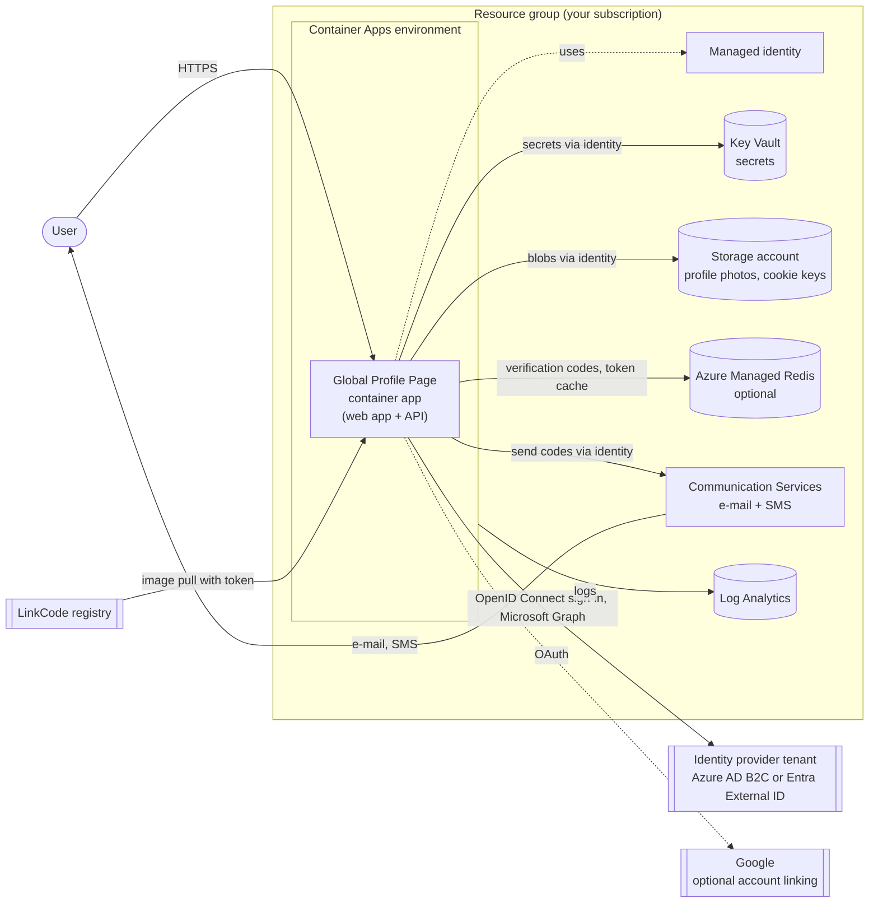

<!-- Generated by scripts/generate.mjs from app.json, architecture.mmd and azuredeploy.json. Do not edit by hand. -->

# Global Profile Page

Self-service account page for users of Azure AD B2C or Entra External ID: profile, password, sign-in methods and activity.

Version **0.5.0** · [all versions](#versions)

## Overview

Customer identity tenants in Azure AD B2C and Entra External ID give users a sign-in page, but no place to look after their own account afterwards. Every change of a phone number, a password or a profile photo ends up as a help desk ticket or as custom code in each application.

Global Profile Page is a ready "My Account" page for those users. After signing in with your existing user flow they edit their profile and photo, change the password, add and verify e-mail and phone sign-in methods with one-time codes, link a Google account and review recent sign-in activity. Changes are written straight to your tenant through Microsoft Graph.

It is meant for organisations that run a B2C or External ID tenant for customers, partners or members and want to give them self-service without building it themselves.

### Features

- View and edit profile details stored in the identity provider tenant
- Upload, replace and remove a profile photo
- Change the password (Azure AD B2C and Entra External ID)
- Add, verify and remove e-mail and phone sign-in methods with one-time codes sent by e-mail or SMS
- Link and unlink a Google account for sign-in
- Review recent sign-in activity
- Optional step-up authentication before sensitive changes
- Works with Azure AD B2C (user flows or custom policies) and Entra External ID

## Architecture

Users open the app over HTTPS and sign in with OpenID Connect against your Azure AD B2C or Entra External ID tenant. The app is one container in a new Container Apps environment: it serves the web interface and its API, keeps the session in an encrypted cookie and holds the tokens on the server.

Profile changes, sign-in methods and sign-in activity are read and written in your identity provider tenant through Microsoft Graph, with the app registration you create. Profile photos and the keys that protect sign-in cookies are stored in a Storage account. Verification codes are sent by e-mail and SMS through Azure Communication Services (e-mail from an Azure managed domain). With Redis on, verification codes and token caches live in Azure Managed Redis so the app can run more than one replica; with Redis off the app runs as one replica with in-memory caches.

The app reaches Key Vault, Storage and Communication Services with its managed identity; client secrets and the registry token are kept in Key Vault. Logs go to a Log Analytics workspace. Outside the resource group the app talks only to your identity provider tenant, to Google when account linking is on, and to the LinkCode registry to pull its image.

### Resources created in your subscription

| Resource | Azure type | Purpose | SKU / plan |
|---|---|---|---|
| Container Apps environment | `Microsoft.App/managedEnvironments` | Hosts the application container | Consumption |
| Global Profile Page | `Microsoft.App/containerApps` | Web interface, sign-in and API in one container | 0.5 vCPU, 1 GiB, 0-30 replicas (1 without Redis) |
| Managed identity | `Microsoft.ManagedIdentity/userAssignedIdentities` | Identity of the app for Key Vault, Storage and Communication Services |  |
| Key Vault | `Microsoft.KeyVault/vaults` | Client secrets, registry token and the Redis connection string | Standard, RBAC, purge protection |
| Storage account | `Microsoft.Storage/storageAccounts` | Profile photos and sign-in cookie protection keys | Standard ZRS, no shared keys |
| Communication Services | `Microsoft.Communication/communicationServices` | Sends verification codes by e-mail and SMS |  |
| Email Communication Service and Azure managed domain | `Microsoft.Communication/emailServices` | Sender domain of verification e-mails |  |
| Azure Managed Redis (optional) | `Microsoft.Cache/redisEnterprise` | Verification codes and token caches shared by replicas | Balanced B0 |
| Log Analytics workspace | `Microsoft.OperationalInsights/workspaces` | Application and platform logs | Pay-as-you-go, 30 days |

## Requirements

- Owner, or Contributor and User Access Administrator, on the target resource group: the template assigns roles to the app's managed identity
- Azure Container Apps, Key Vault, Storage, Communication Services and (with Redis) Azure Managed Redis available in the subscription and region
- An Azure AD B2C or Entra External ID tenant with one app registration for web sign-in and its client secret; the redirect URI is added after the deployment
- Microsoft Graph application permissions on that registration (or on a separate one): User.ReadWrite.All, UserAuthenticationMethod.ReadWrite.All and AuditLog.Read.All (plus Application.Read.All for the optional My Apps page), with admin consent
- Azure AD B2C only: a sign-up/sign-in user flow or custom policy and a ROPC user flow for password checks
- For SMS codes: a phone number or an alphanumeric sender ID in Azure Communication Services (can be added after deployment)
- Optional: a Google OAuth client for account linking
- Image reference and registry token from LinkCode

## Cost

At Azure list prices, approximately:

- **Smallest setup** (Redis off, minimum replicas 0): a few USD per month for Key Vault, Storage and Log Analytics while idle, plus Container Apps for the time the app runs. The first request after an idle period waits a few seconds for a cold start.
- **Typical setup** (Redis on, one replica always running): about 25-50 USD per month: Container Apps for one 0.5 vCPU / 1 GiB replica, Azure Managed Redis Balanced B0 (about 12 USD per month), and a few USD for the rest.

What drives the cost: the number of running replicas, Redis, log volume, and verification messages (each e-mail and SMS segment is charged by Communication Services; an ACS phone number has a monthly fee, an alphanumeric sender ID has none). Check the [Azure pricing calculator](https://azure.microsoft.com/pricing/calculator/) for your region.

## Security and data

- All resources and data stay in your subscription and the region you choose; Communication Services keeps its data in the data location you choose (Europe by default).
- User data is read from and written to your own identity provider tenant through Microsoft Graph; the app keeps no user database. Profile photos are stored in your Storage account.
- Client secrets and the registry token are stored in Key Vault and read by the app's managed identity; the Storage account has shared keys and public blob access turned off.
- Sign-in uses OpenID Connect; tokens stay on the server and the browser holds only an encrypted, HTTP-only session cookie.
- Ingress is public HTTPS only. Verification codes are sent to users by e-mail and SMS through Communication Services.
- Nothing is sent to LinkCode. Outside your subscription the app talks only to your identity provider tenant, Google (when linking is on) and the LinkCode registry (image pull).

## Deployment parameters (version 0.5.0)

The portal form fills these in; the table is for reference and scripted deployments.

| Parameter | Type | Required | Default | Description |
|---|---|---|---|---|
| `name` | string | yes |  | Workload name in every resource name, after the Microsoft abbreviation of its type (Cloud Adoption Framework), for example gpp-prod: ca-gpp-prod, cae-gpp-prod, kv-gpp-prod-… |
| `location` | string | no | `[resourceGroup().location]` | Region of the regional resources. Default: the region of the resource group. |
| `tags` | object | no | `{}` | Extra tags added to every resource, for example the tags a landing zone requires. |
| `containerImage` | string | yes |  | Full image reference, for example <registry>.azurecr.io/com-cis-global-profile-page:1.2.3. |
| `registryUsername` | string | no | `` | User name of the registry token given to this customer. Empty: the image is public and pulled anonymously. |
| `registryPassword` | securestring | no |  | Password of the registry token given to this customer. |
| `minReplicas` | int | no | `1` | 0 scales to zero when idle: cheapest, with a cold start of a few seconds on the next request. |
| `maxReplicas` | int | no | `5` | Ignored without Redis: verification codes and token caches then live in memory, so the app runs as one replica. |
| `enableRedis` | bool | no | `true` | Azure Managed Redis for verification codes and token caches shared by replicas. Off: one replica, in-memory caches; after a restart or scale to zero, pending codes are lost and some changes may ask the user to sign in again. |
| `identityProvider` | string | yes |  | Identity provider of the users: AzureAdB2C or EntraExternalId. |
| `tenantName` | string | no | `` | Name of the identity provider tenant, for example contoso for contoso.onmicrosoft.com. Fills azureAdInstance, azureAdDomain and ropcTokenEndpoint when they are empty. |
| `azureAdInstance` | string | no | `` | Sign-in authority host, for example https://contoso.ciamlogin.com/ or https://contoso.b2clogin.com/. Empty: derived from tenantName. |
| `azureAdDomain` | string | no | `` | Tenant domain, for example contoso.onmicrosoft.com. Empty: derived from tenantName. |
| `azureAdTenantId` | string | no | `` | Tenant id (GUID) of the identity provider tenant used for sign-in. Empty with /setup, which finds it. |
| `azureAdClientId` | string | no | `` | Client id of the web sign-in app registration. Empty (recommended): a tenant administrator runs /setup once after the deployment (outputs setupUrl and setupCode), which creates the registrations in the identity provider tenant and saves their settings in Key Vault. |
| `setupClientId` | string | no | `84c2471e-fef9-4ca6-a089-92ec14682fe0` | Client id of the LinkCode setup app: a multitenant public client that /setup signs the tenant administrator in to with a device code. Keep the default. |
| `azureAdSignUpSignInPolicyId` | string | no | `` | B2C only: sign-up/sign-in user flow or custom policy. Empty for Entra External ID. |
| `azureAdClientSecret` | securestring | no |  | Client secret of the web sign-in app registration. Empty with /setup. |
| `graphTenantId` | string | no | `` | Tenant of the app registration that calls Microsoft Graph in the identity provider tenant. Empty: azureAdTenantId. |
| `graphClientId` | string | no | `` | Client id of the app registration that calls Microsoft Graph. Empty: the web sign-in registration (azureAdClientId and azureAdClientSecret) also calls Graph. |
| `graphClientSecret` | securestring | no |  | Client secret of the app registration that calls Microsoft Graph. Empty when graphClientId is empty. |
| `ropcTokenEndpoint` | string | no | `` | B2C only: token endpoint of the ROPC user flow used to check the current password. Empty: derived from tenantName and ropcPolicyId. |
| `ropcPolicyId` | string | no | `B2C_1_ROPC` | B2C only: name of the ROPC user flow, used with tenantName when ropcTokenEndpoint is empty. |
| `ropcClientId` | string | no | `` | B2C only: client id used with the ROPC user flow. Empty with /setup, which creates it. |
| `userFlow` | string | no | `` | Entra External ID with /setup: the sign-up and sign-in user flow the web registration joins. Empty: add the app to a flow in the admin center. |
| `setupCode` | string | no | `[newGuid()]` | With /setup: the one-time code that opens it (output setupCode). A new one on every deployment; it only works while the app is not set up. |
| `stepUpClaimType` | string | no | `acr` | Token claim checked for step-up authentication. |
| `stepUpRequiredClaimValue` | string | no | `` | Empty: step-up authentication is off. |
| `stepUpB2CPolicy` | string | no | `` | B2C only: user flow or custom policy used for step-up authentication. |
| `stepUpAuthenticationContextId` | string | no | `` | Entra External ID only: Conditional Access authentication context id used for step-up, for example c1. |
| `googleClientId` | string | no | `` | Google OAuth client for account linking. Empty: linking is off. |
| `googleClientSecret` | securestring | no |  | Secret of the Google OAuth client for account linking. |
| `enableVerificationCodes` | bool | no | `true` | Lets users add an e-mail address as a sign-in method with a one-time code, sent by Azure Communication Services (created only when on). Off: no Communication Services resources, e-mail and SMS verification are turned off, and the Security page does not offer adding these methods. |
| `smsSender` | string | no | `` | SMS sender for verification codes: a phone number bought in Azure Communication Services (E.164, for example +48123456789) or an alphanumeric sender ID enabled in ACS (1-11 letters, digits or spaces, at least one letter). Until it is set, adding a phone number is not offered. |
| `communicationDataLocation` | string | no | `Europe` | Data location of Azure Communication Services. |
| `signInActivitySource` | string | no | `IdentityProvider` | Feature flag for the Recent activity page. IdentityProvider: read the tenant sign-in log through Microsoft Graph on demand (short retention). EventHub: create an event hub for the tenant Diagnostic settings and keep sign-ins in the app's own table for signInRetentionDays. |
| `signInRetentionDays` | int | no | `365` | Days the app keeps sign-ins when signInActivitySource is EventHub. |
| `enableMyApps` | bool | no | `false` | Feature flag for the My Apps page: a list of the applications each user signed in to, built from the sign-in history and completed with names, logos and links from the tenant. Needs the Microsoft Graph application permission Application.Read.All on the Graph app registration. |
| `myAppsSource` | string | no | `TokenIssuance` | Where the My Apps page finds the applications. TokenIssuance (default): in Azure AD B2C the audit log's "Issue an id_token to the application" events, which name the application the user signed in to (with signInActivitySource EventHub the tenant Diagnostic setting must stream AuditLogs too); Entra External ID reads its sign-in log either way. SignInLog: the sign-in history, exactly as recorded (under B2C custom policies every sign-in is ProxyIdentityExperienceFramework). |

## After deployment

Deployment outputs (Azure portal > resource group > Deployments):

| Output | Type | Description |
|---|---|---|
| `appUrl` | string | URL of the application. Without /setup, add {appUrl}/signin-oidc as a redirect URI of the web sign-in app registration. |
| `signInRedirectUri` | string | Without /setup: add this redirect URI to the web sign-in app registration (Authentication > Web), then sign in at appUrl. |
| `setupUrl` | string | With /setup: open this page, enter setupCode and sign in as an administrator of the identity provider tenant. Empty otherwise. |
| `setupCode` | string | With /setup: the one-time code the setup page asks for. Empty otherwise. |
| `emailSender` | string | Sender address of verification e-mails (Azure managed domain). Empty when enableVerificationCodes is off. |
| `identityClientId` | string | Client id of the managed identity of the app. |
| `signInLogsAuthorizationRuleId` | string | Feature flag EventHub only: event hub authorization rule to select in the tenant's Diagnostic settings (category SignInLogs, plus AuditLogs when myAppsSource is TokenIssuance). Empty otherwise. |
| `signInLogsEventHubName` | string | Feature flag EventHub only: event hub name to select in the tenant's Diagnostic settings. Empty otherwise. |

1. Add the `signInRedirectUri` output as a redirect URI of the web sign-in app registration (and `<appUrl>/bff/link/google/callback` in the Google client if linking is on).
2. Open the `appUrl` output in a browser and sign in with a user of your tenant.
3. For SMS codes, set up a phone number or an alphanumeric sender ID in the Communication Services resource and deploy again with it, if you did not enter one in the form.
4. Optional: replace the Azure managed e-mail domain with your own domain in the Email Communication Service.

## Versions

| Version | Deploy | Files | Release notes |
|---|---|---|---|
| 0.5.0 |  | [azuredeploy.json](0.5.0/azuredeploy.json), [createUiDefinition.json](0.5.0/createUiDefinition.json) |  |
| 0.4.0 |  | [azuredeploy.json](0.4.0/azuredeploy.json), [createUiDefinition.json](0.4.0/createUiDefinition.json) |  |
| 0.3.0 |  | [azuredeploy.json](0.3.0/azuredeploy.json), [createUiDefinition.json](0.3.0/createUiDefinition.json) |  |
| 0.2.0 |  | [azuredeploy.json](0.2.0/azuredeploy.json), [createUiDefinition.json](0.2.0/createUiDefinition.json) |  |
